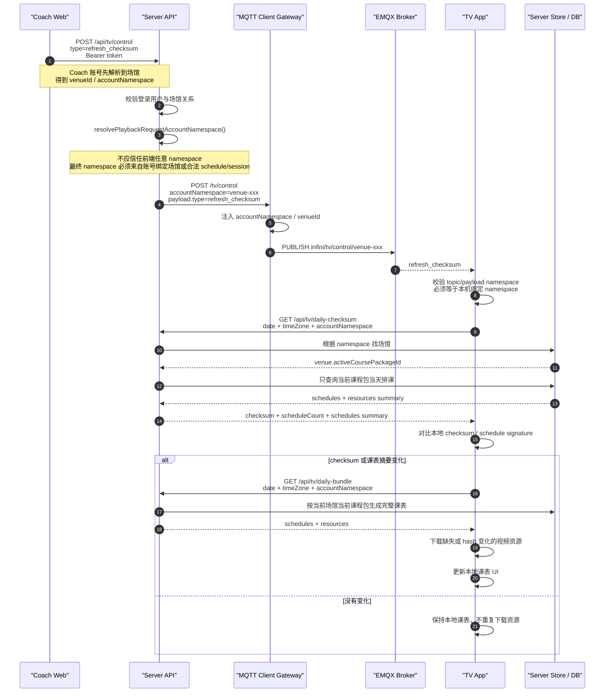
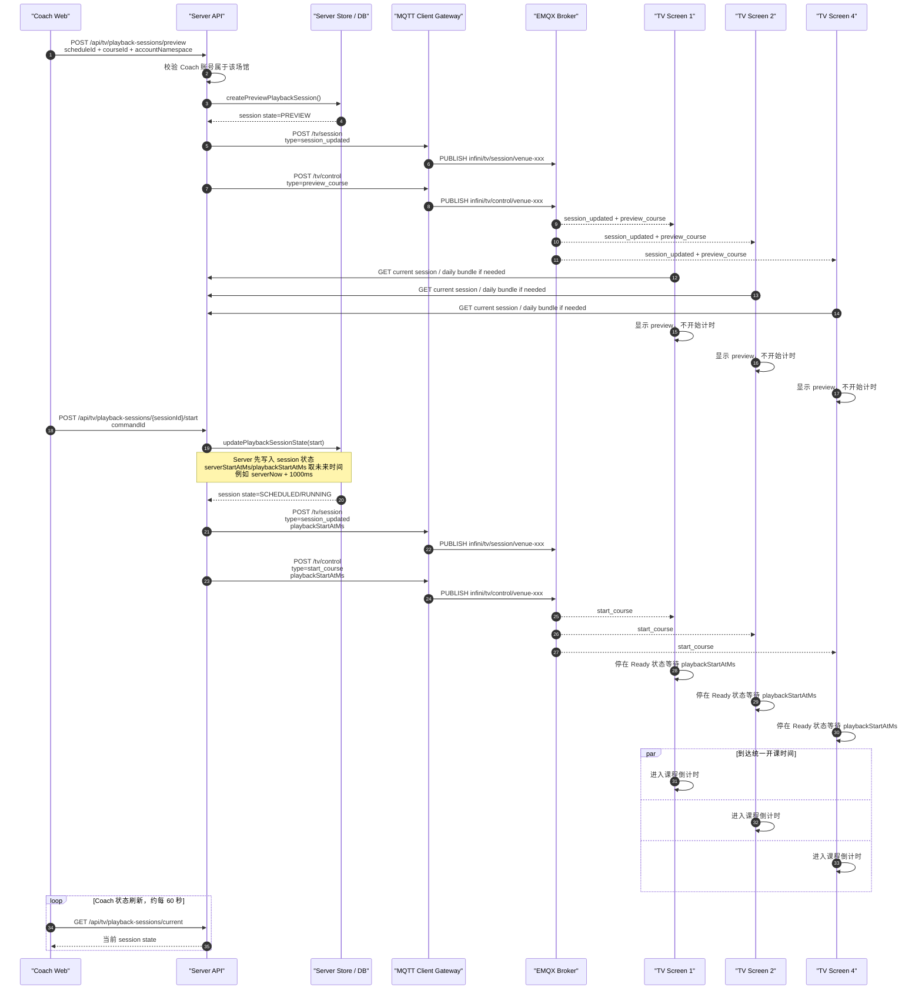

# Coach 控制 TV 课表刷新与开课时序

本文描述 Coach 端发起「刷新 TV 课表」和「开始课程」时，Coach Web、Server、MQTT Client Gateway、EMQX、TV App 之间的完整链路。重点说明场馆 `accountNamespace` 如何贯穿系统，避免不同场馆之间消息串发、课表串读。

## 核心约定

当前系统使用场馆命名空间作为 TV 侧隔离边界：

```text
accountNamespace = venue.accountNamespace
例如：venue-432a10d5
```

MQTT topic 约定：

```text
控制指令 topic: infini/tv/control/{accountNamespace}
Session 事件 topic: infini/tv/session/{accountNamespace}
未绑定设备 topic: infini/tv/control/__unbound__
```

TV 绑定后保存：

```json
{
  "deviceId": "TV-xxxx",
  "screenNumber": 1,
  "accountNamespace": "venue-432a10d5"
}
```

TV 绑定后只订阅自己的场馆 topic，并且收到 payload 后会校验 payload 或 topic 中的 namespace 是否等于本机绑定的 `accountNamespace`。

## 刷新 TV 课表

Coach 点击「刷新 TV」后，不直接连接 MQTT。Coach Web 只调用 Server HTTP API，由 Server 或 MQTT Client Gateway 统一发 MQTT。



### 刷新课表内部逻辑

Server 侧关键逻辑：

```text
accountNamespace -> venue -> activeCoursePackageId -> schedules
```

TV 侧关键逻辑：

```text
refresh_checksum MQTT
-> daily-checksum
-> checksum / schedule signature 对比
-> 必要时 daily-bundle
-> 资源 hash 对比
-> 只下载缺失或变化资源
```

这意味着 `daily-checksum` 是必要接口，不能绕过。它不仅判断课程内容是否变化，也要覆盖「排课数量、排课时间、课程 ID、课程包 ID、资源 hash」等会影响 TV 展示的字段。

## 预览与开始课程

Coach 点击课程 item 后进入 preview；再次点击开始后进入正式课程。正式开始必须由 Server 先创建或更新 playback session，再发 MQTT。TV 以 Server 下发的 `playbackStartAtMs` 作为统一开课时间。



### 开始课程内部逻辑

Server 必须先更新 session，再发 MQTT：

```text
POST start
-> updatePlaybackSessionState(start)
-> session.serverStartAtMs = serverNow + delay
-> publish session_updated
-> publish start_course
```

TV 收到 `start_course` 后不应该立刻按收到消息的时间开课，而是：

```text
收到 start_course
-> 确认 accountNamespace
-> 拉取或校验 authoritative session
-> 停在 Ready 状态
-> 等到 playbackStartAtMs
-> 按 serverStartAtMs / 本机单调时间计算课程进度
```

如果某台屏幕晚 1 秒收到 MQTT，它也应该根据同一个 `playbackStartAtMs` 计算当前 offset，并跳到正确进度，而不是从 0 重新开始。

## 场馆隔离能否保证不串

在当前设计下，可以防止「业务逻辑层面的串场」，前提是下面四条都成立：

```text
1. Coach/Admin 的 HTTP API 不能信任前端随便传 accountNamespace。
2. Server 必须从登录账号、场馆、schedule、session 解析最终 accountNamespace。
3. Server/MQTT Gateway 只能发布到 infini/tv/control/{accountNamespace} 和 infini/tv/session/{accountNamespace}。
4. TV 绑定后只订阅自己的 accountNamespace，并拒绝不匹配 namespace 的 payload。
```

也就是说，A 场馆的 Coach 操作应该只能发布到：

```text
infini/tv/control/venue-a
infini/tv/session/venue-a
```

B 场馆 TV 只订阅：

```text
infini/tv/control/venue-b
infini/tv/session/venue-b
```

所以 B 场馆不会收到 A 场馆消息。

### 还需要注意的风险

当前隔离主要依赖应用层逻辑和 topic 命名。它能避免正常业务误发，但如果后续要做更强安全隔离，建议增加 EMQX ACL：

```text
TV clientId/deviceId 只能 subscribe 自己绑定的 namespace。
Server/mqtt-client 只能 publish 合法 namespace。
普通 Web 端不直接连接 MQTT。
```

这不是现在功能能否跑通的前置条件，但它是后续多场馆、多客户规模化后的硬隔离方案。

## 需要重点监控的日志字段

为了排查某个屏幕不刷新、某个场馆串消息，日志至少要带以下字段：

```text
commandId
type
topic
accountNamespace / venueId
deviceId
screenNumber
scheduleId
courseId
coursePackageId
checksum
sessionId
playbackStartAtMs
serverNowMs
```

推荐排查顺序：

```text
Coach HTTP 请求是否带对场馆
-> Server 解析出的 accountNamespace 是否正确
-> MQTT Gateway 发布 topic 是否正确
-> EMQX 是否有对应 topic 消息
-> TV 是否收到该 topic
-> TV 是否因为 namespace 校验拒绝
-> TV daily-checksum 是否返回变化
-> TV 是否继续拉 daily-bundle
```

## 结论

刷新课表和开始课程都应该以场馆 `accountNamespace` 为主线：

```text
Coach 登录账号
-> 账号绑定场馆
-> 场馆 accountNamespace
-> 场馆当前课程包
-> 场馆专属 MQTT topic
-> TV 本地绑定 namespace
```

只要 Server 不允许 Coach 任意指定别的场馆 namespace，TV 又只订阅和处理自己的 namespace，那么不同场馆之间不会互相收到控制消息，也不会拉到对方课程包的课表。
