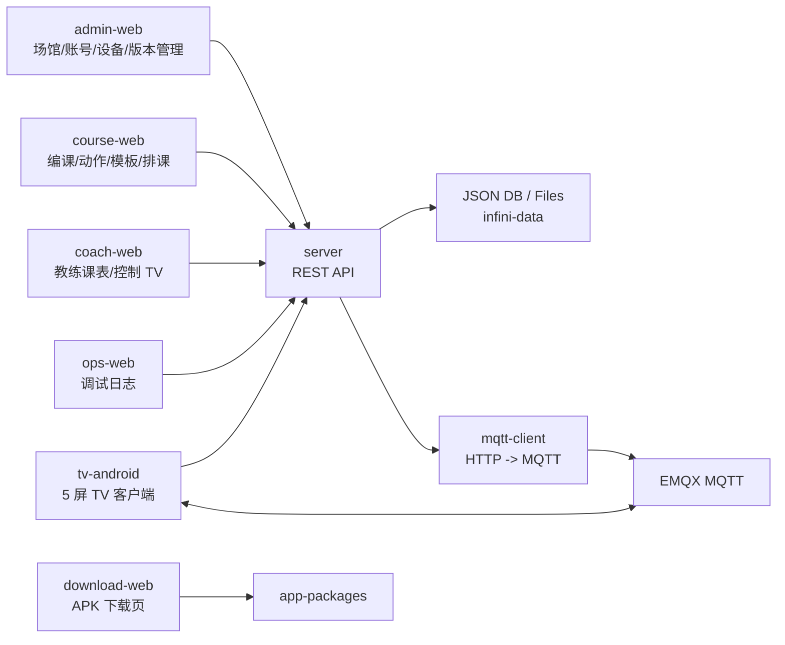

# Infini Code Map

这个文档是 workspace 级别的代码地图，用来快速判断“某个需求应该改哪个仓库”。

公开版本中以下项目直接位于同一个仓库内，不再使用 submodule。业务边界不变；脱敏、历史分支及部署配置限制见 [PUBLIC_EXPORT.md](PUBLIC_EXPORT.md)。

需求进入开发前，先在 [requirements 工作区](requirements/README.md) 建立或更新对应文档，再根据本代码地图判断影响端。

## System Topology

## Repository Boundaries

### `apps/server`

负责后端业务和数据安全：

- 登录、refresh token、用户权限。
- 场馆、账号、课程包、设备绑定。
- 动作、课程、课程模板、排课。
- TV 今日课表、checksum、bundle、播放 session。
- TV 版本包登记、下载、扫描。
- 对外提供 REST API，Web 端不直接改数据库。

内部结构约定：

- `src/data/json-store/browser-session-store.ts`：独立 Web 会话域；按 `browserClient`/浏览器 Cookie 分离，固定随机 Cookie 的 hash 持久化，12h 访问租约、15d 绝对上限；续期/退出只作用于对应会话，不改课程和场馆数据。
- `src/interfaces/http/browser-session-auth.ts`：请求入口的 Cookie/CSRF 适配，`/api/browser-auth/{client}/{login,refresh,logout}` 与明确的 client/session header；角色权限在服务端校验，TV/旧 Bearer 兼容路径不变。
- `packages/shared/src/browser-session.ts`：所有 Web 的 Cookie 请求、一次鉴权重试、同页续期合并、跨标签页公开身份同步、迟到响应保护；`course/admin/coach` 的 `src/services/browserSession.ts` 为各端配置；Ops 与模拟器使用同一工具，模拟器复用 course 会话。
- `tests/browser-sessions.test.ts`、`tests/browser-session-client.test.ts`：分端/跨浏览器会话、权限/CSRF、续期、网络失败和竞态回归；`tests/browser-session-smoke.ts` 使用临时 DB、已构建 Web 与本机 Chrome 验证真实 Cookie、多标签与登录 UI，不连接生产。

- `src/interfaces/http/compat-request-handler.ts`：承载现有 REST API 和旧客户端协议兼容，请求兼容逻辑集中放在这里。
- `src/data/json-file-store.ts`：JSON DB store public barrel，只 re-export 业务域 store。
- `src/data/json-store/core.ts`：共享 JSON DB state、storage root、备份、normalize/derive/scope helper。
- `src/data/json-store/media-app-store.ts`：媒体文件和 TV app package 上传、登记、下载。
- `src/services/media-thumbnails.ts`：动作视频服务端缩略图派生缓存，按 action/media 版本生成 JPG，不写入 DB。
- `src/services/media-delivery.ts`：校验本地媒体路径、生成 immutable/ETag/Last-Modified 响应并在配置开启时通过 `X-Accel-Redirect` 把文件发送交给 Nginx；未开启时回退到 Node Range 流。
- `src/interfaces/http/tv-diagnostic-upload.ts`：`POST /api/tv/diagnostics` 接收有大小/超时限制的 JSONL 文件；通过 `tv-store.authenticateTvDiagnosticUpload` 只读验证设备私有绑定，不暴露 pair token、不写 DB。
- `src/services/tv-diagnostic-schema.ts`：错误类型/code/message/时间 schema、context 白名单、敏感信息脱敏及设备身份校验；`simulatorDiagnosticIdentity` 从已认证账号构造网页模拟器身份。
- `POST /api/websimulator/diagnostics`：复用有界 JSONL 上传/10 天文件保留，不写 DB；`GET /api/ops/tv-diagnostics?source=websimulator` 仅 super admin 查询，旧 TV 文件 source 默认 tv。
- `apps/websimulator/src/diagnostics.ts`：统一脱敏、短期去重、20 条本地补传队列、独立有超时的上传和 JS/播放器错误捕获；`api.ts` 记录最终接口错误，`mediaCache.ts` 记录下载/校验错误及课程/动作上下文。Ops 可按来源筛选。
- `tools/migration/ecs-20261014/infini-routes.conf`：`/infini/simulator-media/oss-shanghai/*` 固定代理公共 OSS Bucket，HTTPS 校验、剥离 Authorization/Cookie；旧 `/simulator-media/oss-shanghai/*` 同源 307 到新前缀，兼容已打开的模拟器页面。
- `src/services/tv-diagnostic-files.ts`：诊断文件落入 `INFINI_DATA_ROOT/tv-diagnostics`，以北京时间/场馆/设备分目录，带屏幕和版本文件名；原子写入、幂等、限流/额度、32 个待处理操作上限，启动与每小时清理接收时间满 10 天的日志；为 Ops 提供有文件数/字节上限的只读分类查询，不返回路径和校验摘要。
- `src/interfaces/http/compat-request-handler.ts`：`GET /api/ops/tv-diagnostics` 仅允许 super admin，按日期、场馆、设备、屏幕、六类错误和错误码过滤脱敏记录。
- `scripts/nginx-infini-media-*.conf`：Nginx http/server 两层媒体配置；通过 `/srv/infini-media` bind mount 读取应用媒体，不放宽 home 权限；用设备 ID + 屏幕号 + URI 识别同资源并发，静态 `sendfile` 和独立 JSON access log 只作用于 TV 媒体内部 location。
- 生产 OSS Bucket 的对象访问由 OSS 服务端访问日志记录到 `oss-access-logs/`；生命周期规则 `expire-infini-oss-access-logs-30d` 只清理该前缀下超过 30 天的日志，不影响媒体对象。计量与费用仍以 OSS 监控和账单为准。
- `scripts/deploy-remote.sh`：识别线上 `infini-platform.service` 并通过 systemd 重启，写入媒体 X-Accel drop-in 后轮询健康检查；仅在没有 systemd unit 的环境回退到独立 Node 进程。
- `src/data/json-store/admin-store.ts`：用户、场馆、课程包、管理端元数据。
- `src/data/json-store/content-store.ts`：动作、动作类型、课程、课程模板。
- 课程包 `accessScope=GLOBAL` 是测试包的显式全局读写能力；Server scope helper 负责统一放宽动作、类型、课程、模板和跨包排课引用，普通课程包仍为 `PACKAGE_ONLY`。
- `src/data/json-store/schedule-store.ts`：排课、复制排课、未来无效排课清理。
- `GET /api/schedules/week`：Course 首页使用的轻量周课表读取接口，按 `date` 所在周和 `coursePackageId` 过滤，只返回 schedule basics，不携带课程脚本。
- `GET /api/meta`：默认兼容返回课程 summary、actions、templates；`includeSchedules=0` 可关闭课表，`includeActions=0` / `includeTemplates=0` 可关闭编辑重集合；`courseDetail=full&courseId=ID` 只返回单课程 full；无 `courseId` 的 `courseDetail=full` 仅作为兼容兜底。
- `src/data/json-store/tv-store.ts`：TV 今日课表、bundle、屏幕、设备、播放 session。
- `src/data/store-gateway.ts`：给 Nest 模块和 request 适配层使用的 store 访问网关。
- `src/runtime/*`：启动时装配 request handler 和 store 的入口。
- 不再新增 `src/legacy` 或 `.txt` chunks；如果业务继续拆分，应进入明确的 domain/service/repository 模块。

### `apps/mqtt-client`

负责统一 MQTT 下发：

- Web 端不直接连接 MQTT。
- Coach/Admin 调用 HTTP，由 mqtt-client 统一发布 MQTT。
- MQTT 协议和 topic 保持简单，按场馆 namespace 隔离。
- 适合集中记录指令日志，排查“指令是否发出”。

### `apps/admin-web`

场馆管理端：

- 只有超级管理员可以登录。
- 管理场馆、场馆账号、编课账号、课程包。
- 查看场馆设备在线、版本、屏幕绑定。
- 给单台或批量 TV 下发更新指令。
- 不负责编辑课程内容。
- 全局样式入口为 `src/App.css`，按顺序加载 `src/styles/visual-refresh/*`。视觉模块按基础令牌、壳层导航、管理内容、设备、版本、表格弹窗和响应式职责拆分；新增页面应复用这些工作台样式，不回写紫色渐变或无语义的大型 CSS 块。

### `apps/course-web`

编课端：

- 编课人员和超级管理员使用。
- 按课程包隔离动作、课程、模板、排课。
- 当前课程包为 `GLOBAL` 测试包时，列表可直接读写所有课程包资源；跨包资源显示来源课程包，已有资源保存时保持原归属，新建资源归属测试包。
- 管理动作视频、动作分类、课程脚本、课程计划。
- 首页课表不从 meta 读取 full course/schedules/actions/templates；先拉轻量 meta，再通过 `/api/schedules/week` 按周读取课表。
- 课程列表使用 course summary；进入课程编辑器或从已有课程生成整课模板时，才通过 `/api/courses/:id` 拉单课程完整脚本。
- 动作视频展示默认走服务端派生缩略图 + 浏览器本地 IndexedDB 缓存，只有用户点击播放时才加载视频。
- 三屏视频组的 rowLayouts 是编课者显式添加/删除的行数，最多 5 行；不再自动从 3 行两列扩展到 5 行。
- 课程模板用于快速生成课程骨架。
- 排课后的课程会被 TV/Coach 按当前场馆课程包读取。
- 基础历史样式仍由 `src/App.css` 加载，新版视觉覆盖集中在 `src/styles/visual-refresh/*`，按令牌、壳层导航、排课编辑、动作/模板、弹窗管理和响应式职责拆分。新增界面必须放入对应语义模块，保持炭黑工作台、金色信息和蓝色操作层级。

### `apps/coach-ios`

- 独立 SwiftUI iOS 17+ 学习版，入口 `InfiniCoach.xcworkspace`；不改变 Server/TV/Web 协议。
- `InfiniCoach/InfiniCoachApp.swift` 为 App 入口；`Packages/CoachKit` 本地 Swift Package 按 Models/Networking/Services/Features 分层。
- `APIClient.swift` 统一 Alamofire 请求、Cookie/Origin/client header、一次续期重试；`CredentialStore.swift` 使用独立 Keychain 凭据，不与网页会话共用。
- `CoachService.swift` 复用 Coach API；`DemoCoachService.swift` 仅本机数据，不下发真实 TV 命令。
- `CoachModel.swift` 管理前台 session 同步、日期请求代次、至少 2 秒全局控制锁；仅绑定场馆账号可操作真实环境。
- TabView/NavigationStack 原生导航；课程/动作详情 push，日期 sheet，危险操作 confirmationDialog；Kingfisher 缓存图片，AVKit 点击后加载视频。
- `InfiniCoachTests` / `InfiniCoachUITests` 覆盖假接口与原生导航，`scripts/test.sh` 在模拟器执行，无生产写入。

### `apps/coach-web`

教练端：

- 场馆账号登录。
- 查看当前场馆当前课程包的课表。
- 切换场馆已绑定课程包。
- 控制 TV：刷新课表、显示计划、预览、开始、暂停、结束。
- 查看现场屏幕在线状态和基础调试信息。
- 手机优先视觉集中在 `src/coach-web.css`；保持紧凑深色控制台、至少 44px 的关键触控区域、金色信息和蓝色命令状态，并持续验证中英俄长文本与窄屏布局。

### `apps/tv-android`

Android TV 客户端：

- 通过扫码绑定到场馆和屏幕号。
- 按场馆 namespace 订阅 MQTT。
- 拉取今日课程、checksum 和课程资源。
- MQTT 控制指令只作为通知；实际预览/开始/结束状态以 `/api/tv/playback-sessions/current` 为唯一状态源。
- 课程资源同步中收到 preview/start 会记录 pending apply，同步完成后重新拉 current 再应用；TERMINATED/ENDED 优先取消 pending，避免慢屏幕补执行过期指令。
- 竖屏训练物理屏幕 1/3/5 对应课程脚本逻辑屏幕 1/2/3，物理屏幕 4 当前不参与训练视频。
- 物理屏幕 1/3/5 使用 `CACHE_REQUIRED` 缓存课程视频；横屏信息屏 2/4 使用 `METADATA_ONLY`，包括按 schedule 兜底加载时也不下载 MP4。
- TV 媒体缓存请求携带 device/screen/checksum/app-version header；遇到 `429`、临时 `5xx` 或网络错误只做有限指数退避，下载完成后仍以 size/checksum 校验为准。
- 训练卡片和 warm up/cool down 的 `VideoView` 只接受存在、可读、非空的本地文件；远程 URL 或缺失缓存显示占位，不进行远程串流和无限播放重试。
- `InfiniApplication` 初始化 `diagnostics/TvDiagnostics`；`DiagnosticEvent` 统一事件与脱敏，`DiagnosticOutbox` 负责本地限额文件，`DiagnosticUploadPump` 负责后台补传/退避。Java crash 先同步落盘再交给 Android 原 handler，下次启动补传。
- `diagnostics/DiagnosticHttpEvents` 接入公共 OkHttp 客户端，统一记录 API/下载 HTTP 错误及网络失败；`PlayerDiagnostics` 接入训练和热身/冷身 VideoView，记录本地媒体错误码且保留原恢复行为；媒体缓存入口单独记录最终下载/校验失败。
- `repository/DiagnosticUploadClient` 通过 `ApiClient.requestFile` 复用请求封装与兼容地址选择，但独立 fallback 计数、15 秒超时、禁用自身错误上报，避免递归日志和影响课程请求。日志不通过 MQTT，也不进入视频缓存或 OSS。
- RUNNING 进度使用服务端 `serverNowMs/serverStartAtMs` 和请求 RTT 修正，避免不同盒子本机时间差导致 1/3/5 屏不同步。
- 横屏进度条下方正式训练时间仅对 `venue-432a10d5` 测试场馆显示，口径对齐编课端 `trainingSeconds`：包含正式 pod 内部训练时间，排除 warm up、cool down 和 pod ending hydrate/move zone。
- Pod 结束过渡时长由 `script.training.pods[].endingSeconds` 独立控制；历史课程缺失时回退 `script.metadata.defaultHydrateSeconds`。Shared summary、Course editor 与 TV timeline 必须保持同一口径。
- `script.metadata.stationRules`（Set / Work / Rest / Switch）属于课程展示元数据，不参与 Pod work/rest/循环、课程时序或 TV 播放计算。
- SWITCH Pod 的 `loopCount` 表示 AB 轮次数，独立于视频卡和 AB 对数量；第 n 轮按视频卡相邻配对循环取 AB。A→B 使用 SWITCH，同一 AB 多组间使用 REST，AB 轮次之间使用 MOVE STATION；Shared/Server 摘要与 session 时长、Course/Admin 计时、Web Simulator 以及 TV 竖屏/横屏时间线必须保持一致。
- 播放竖屏/横屏不同 UI。
- 支持课程同步、暂停、结束、计划展示、静默更新。
- TV 视觉资源集中在 `app/src/main/res/values/colors.xml`、`themes.xml` 与 `res/drawable`，主界面结构集中在 `res/layout/activity_main.xml`；`MainActivityReadyResponsiveController` 负责竖/横屏状态带尺寸，`MainActivityTrainingCardRendererController` 与 `MainActivityWaterfallPlaybackController` 负责动作名称覆盖层，`HorizontalProgressBarComponent` 只绘制横屏单条训练进度。Java 动态生成的课表、训练卡、课程计划和设置项必须复用同一视觉资源。视觉调整不得改变现有 View ID、MVI surface、屏幕映射或点击/播放行为。

### `apps/download-web`

TV APK 下载页：

- 面向人工下载或现场维护。
- 读取服务器 APK 版本列表。
- 不承载业务控制逻辑。

### `apps/ops-web`

运维调试页面：

- `src/OpsWebApp.tsx` 默认提供 TV 错误日志视图，按播放、下载、网络、API、MQTT、崩溃六类统计和筛选，列表选择后显示 message/context/stack trace。
- 保留 MQTT 与设备总览视图，通过顶部切换进入。
- 帮助排查同步、下发指令、设备在线等问题。
- 不面向普通教练和编课人员。

## Runtime Domains

| URL Path On `https://114.215.185.184` | Service |
| --- | --- |
| `/infini/api/*` | Server API |
| `/infini/admin/` | Admin Web |
| `/infini/course/` | Course Web |
| `/infini/coach/` | Coach Web |
| `/infini/download/` | Download Web |
| `/infini/ops/` | Ops Web |
| `/infini/course/simulator/` | Web Simulator |

生产客户端通过 HTTPS/443 访问 API 和媒体，通过 `wss://114.215.185.184/infini/mqtt` 访问 MQTT。Nginx 的 80 监听负责 HTTPS 跳转和 IP 证书续期；内部 API/网关/broker 仅监听 `127.0.0.1:3100/3205/8083`。本地调试构建可使用局域网 HTTP/MQTT TCP，不进入生产包。

## MQTT Isolation

场馆隔离依赖 `accountNamespace` / venue namespace。

约定：

- TV 绑定后只订阅自己场馆的 topic。
- Coach/Admin 发控制指令时必须带场馆 namespace。
- 服务端/网关负责根据场馆发送到对应 topic。
- 不同场馆之间不共享控制消息。
- 生产 MQTT 仅暴露 WSS/443，不提供 TCP/1883 或明文 WebSocket 回退。

## Deployment Notes

- 生产运行目标迁移到 Aliyun ECS `i-bp1gy4to0n4dh5gk7tuw`；运维和部署通过 Workbench 连接，不再把旧公网 SSH 地址作为部署目标。
- 新 ECS 与 TMY 服务共用 Nginx 80/443，通过 `/infini/*` 路径分流；Infini 内部端口为 `127.0.0.1:3100/3205/8083`。
- 生产数据目录迁移为 `/var/lib/infini`，TV APK 位于 `/var/lib/infini/app-packages`；旧服务器目录在迁移观察期内只作为回滚源保留。
- API 和 Web 使用新 ECS 已有 IP SAN 证书，`tmy-certificate-renew.timer` 自动续期并验证/reload Nginx。
- API Base 为 `https://114.215.185.184/infini`，MQTT 为 `wss://114.215.185.184/infini/mqtt`；TV 1.0.77 和所有 Web 重建到该地址。
- `src/utils/public-resource-url.ts` 在 Server JSON/MQTT 输出边界转换资源链接，不修改数据库中的媒体记录。Web request/upload/SSE 使用统一 resolver，模拟器和 Course 共用独立的 `infini-course-web-auth` 登录缓存。
- `tools/migration/workbench-deploy-web.sh`、`workbench-deploy-server.sh` 以实例 ID 发布，保存构建备份并检查健康状态；新机配置与回滚步骤见 `tools/migration/ecs-20261014/`。
- `1.0.35` 之前的 TV 包已清理。
- 每个项目单独构建、单独提交、单独 push。

## Requirement Maintenance

- 新需求先写 `docs/requirements/REQ-YYYYMMDD-short-slug.md`。
- 如果需求改变了系统边界、数据流、部署方式或端职责，需要同步更新本代码地图。
- 如果需求延续/覆盖已有需求，在新文档的 `Related Existing Requirements` 中链接旧文档。
- 涉及数据库字段、课程包隔离、TV 播放或 MQTT 的需求，必须写兼容策略和手工 E2E 验收用例。
