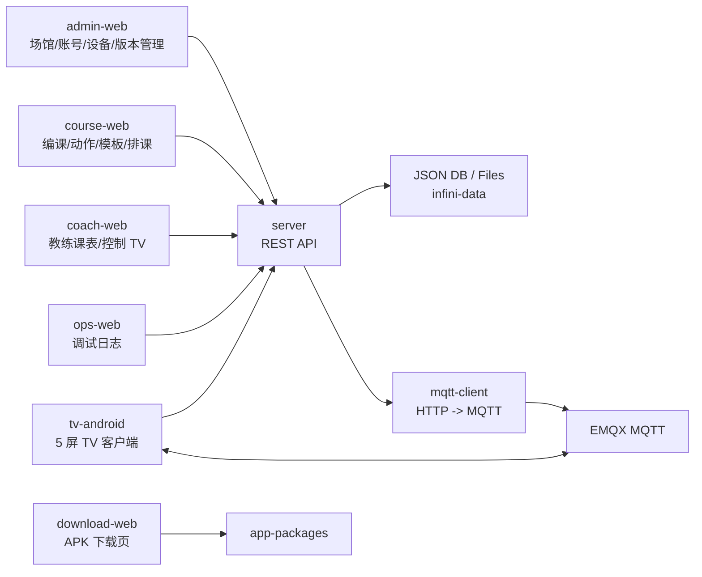

# Infini Code Map

这个文档是 workspace 级别的代码地图，用来快速判断“某个需求应该改哪个仓库”。

需求进入开发前，先在 [requirements 工作区](requirements/README.md) 建立或更新对应文档，再根据本代码地图判断影响端。

## System Topology

## Repository Boundaries

### `apps/server`

负责后端业务和数据安全：

- 登录、refresh token、用户权限。
- 场馆、账号、课程包、设备绑定。
- 动作、课程、课程模板、排课。
- TV 今日课表、checksum、bundle、播放 session。
- TV 版本包登记、下载、扫描。
- 对外提供 REST API，Web 端不直接改数据库。

内部结构约定：

- `src/interfaces/http/compat-request-handler.ts`：承载现有 REST API 和旧客户端协议兼容，请求兼容逻辑集中放在这里。
- `src/data/json-file-store.ts`：JSON DB store public barrel，只 re-export 业务域 store。
- `src/data/json-store/core.ts`：共享 JSON DB state、storage root、备份、normalize/derive/scope helper。
- `src/data/json-store/media-app-store.ts`：媒体文件和 TV app package 上传、登记、下载。
- `src/services/media-thumbnails.ts`：动作视频服务端缩略图派生缓存，按 action/media 版本生成 JPG，不写入 DB。
- `src/services/media-delivery.ts`：校验本地媒体路径、生成 immutable/ETag/Last-Modified 响应并在配置开启时通过 `X-Accel-Redirect` 把文件发送交给 Nginx；未开启时回退到 Node Range 流。
- `scripts/nginx-infini-media-*.conf`：Nginx http/server 两层媒体配置；通过 `/srv/infini-media` bind mount 读取应用媒体，不放宽 home 权限；用设备 ID + 屏幕号 + URI 识别同资源并发，静态 `sendfile` 和独立 JSON access log 只作用于 TV 媒体内部 location。
- `scripts/deploy-remote.sh`：识别线上 `infini-platform.service` 并通过 systemd 重启，写入媒体 X-Accel drop-in 后轮询健康检查；仅在没有 systemd unit 的环境回退到独立 Node 进程。
- `src/data/json-store/admin-store.ts`：用户、场馆、课程包、管理端元数据。
- `src/data/json-store/content-store.ts`：动作、动作类型、课程、课程模板。
- 课程包 `accessScope=GLOBAL` 是测试包的显式全局读写能力；Server scope helper 负责统一放宽动作、类型、课程、模板和跨包排课引用，普通课程包仍为 `PACKAGE_ONLY`。
- `src/data/json-store/schedule-store.ts`：排课、复制排课、未来无效排课清理。
- `GET /api/schedules/week`：Course 首页使用的轻量周课表读取接口，按 `date` 所在周和 `coursePackageId` 过滤，只返回 schedule basics，不携带课程脚本。
- `GET /api/meta`：默认兼容返回课程 summary、actions、templates；`includeSchedules=0` 可关闭课表，`includeActions=0` / `includeTemplates=0` 可关闭编辑重集合；`courseDetail=full&courseId=ID` 只返回单课程 full；无 `courseId` 的 `courseDetail=full` 仅作为兼容兜底。
- `src/data/json-store/tv-store.ts`：TV 今日课表、bundle、屏幕、设备、播放 session。
- `src/data/store-gateway.ts`：给 Nest 模块和 request 适配层使用的 store 访问网关。
- `src/runtime/*`：启动时装配 request handler 和 store 的入口。
- 不再新增 `src/legacy` 或 `.txt` chunks；如果业务继续拆分，应进入明确的 domain/service/repository 模块。

### `apps/mqtt-client`

负责统一 MQTT 下发：

- Web 端不直接连接 MQTT。
- Coach/Admin 调用 HTTP，由 mqtt-client 统一发布 MQTT。
- MQTT 协议和 topic 保持简单，按场馆 namespace 隔离。
- 适合集中记录指令日志，排查“指令是否发出”。

### `apps/admin-web`

场馆管理端：

- 只有超级管理员可以登录。
- 管理场馆、场馆账号、编课账号、课程包。
- 查看场馆设备在线、版本、屏幕绑定。
- 给单台或批量 TV 下发更新指令。
- 不负责编辑课程内容。

### `apps/course-web`

编课端：

- 编课人员和超级管理员使用。
- 按课程包隔离动作、课程、模板、排课。
- 当前课程包为 `GLOBAL` 测试包时，列表可直接读写所有课程包资源；跨包资源显示来源课程包，已有资源保存时保持原归属，新建资源归属测试包。
- 管理动作视频、动作分类、课程脚本、课程计划。
- 首页课表不从 meta 读取 full course/schedules/actions/templates；先拉轻量 meta，再通过 `/api/schedules/week` 按周读取课表。
- 课程列表使用 course summary；进入课程编辑器或从已有课程生成整课模板时，才通过 `/api/courses/:id` 拉单课程完整脚本。
- 动作视频展示默认走服务端派生缩略图 + 浏览器本地 IndexedDB 缓存，只有用户点击播放时才加载视频。
- 三屏视频组的 rowLayouts 是编课者显式添加/删除的行数，最多 5 行；不再自动从 3 行两列扩展到 5 行。
- 课程模板用于快速生成课程骨架。
- 排课后的课程会被 TV/Coach 按当前场馆课程包读取。

### `apps/coach-web`

教练端：

- 场馆账号登录。
- 查看当前场馆当前课程包的课表。
- 切换场馆已绑定课程包。
- 控制 TV：刷新课表、显示计划、预览、开始、暂停、结束。
- 查看现场屏幕在线状态和基础调试信息。

### `apps/tv-android`

Android TV 客户端：

- 通过扫码绑定到场馆和屏幕号。
- 按场馆 namespace 订阅 MQTT。
- 拉取今日课程、checksum 和课程资源。
- MQTT 控制指令只作为通知；实际预览/开始/结束状态以 `/api/tv/playback-sessions/current` 为唯一状态源。
- 课程资源同步中收到 preview/start 会记录 pending apply，同步完成后重新拉 current 再应用；TERMINATED/ENDED 优先取消 pending，避免慢屏幕补执行过期指令。
- 竖屏训练物理屏幕 1/3/5 对应课程脚本逻辑屏幕 1/2/3，物理屏幕 4 当前不参与训练视频。
- 物理屏幕 1/3/5 使用 `CACHE_REQUIRED` 缓存课程视频；横屏信息屏 2/4 使用 `METADATA_ONLY`，包括按 schedule 兜底加载时也不下载 MP4。
- TV 媒体缓存请求携带 device/screen/checksum/app-version header；遇到 `429`、临时 `5xx` 或网络错误只做有限指数退避，下载完成后仍以 size/checksum 校验为准。
- 训练卡片和 warm up/cool down 的 `VideoView` 只接受存在、可读、非空的本地文件；远程 URL 或缺失缓存显示占位，不进行远程串流和无限播放重试。
- RUNNING 进度使用服务端 `serverNowMs/serverStartAtMs` 和请求 RTT 修正，避免不同盒子本机时间差导致 1/3/5 屏不同步。
- 横屏进度条下方正式训练时间仅对 `venue-432a10d5` 测试场馆显示，口径对齐编课端 `trainingSeconds`：包含正式 pod 内部训练时间，排除 warm up、cool down 和 pod ending hydrate/move zone。
- Pod 结束过渡时长由 `script.training.pods[].endingSeconds` 独立控制；历史课程缺失时回退 `script.metadata.defaultHydrateSeconds`。Shared summary、Course editor 与 TV timeline 必须保持同一口径。
- `script.metadata.stationRules`（Set / Work / Rest / Switch）属于课程展示元数据，不参与 Pod work/rest/循环、课程时序或 TV 播放计算。
- SWITCH Pod 的 `loopCount` 表示 AB 轮次数，独立于视频卡和 AB 对数量；第 n 轮按视频卡相邻配对循环取 AB。A→B 使用 SWITCH，同一 AB 多组间使用 REST，AB 轮次之间使用 MOVE STATION；Shared/Server 摘要与 session 时长、Course/Admin 计时、Web Simulator 以及 TV 竖屏/横屏时间线必须保持一致。
- 播放竖屏/横屏不同 UI。
- 支持课程同步、暂停、结束、计划展示、静默更新。

### `apps/download-web`

TV APK 下载页：

- 面向人工下载或现场维护。
- 读取服务器 APK 版本列表。
- 不承载业务控制逻辑。

### `apps/ops-web`

运维调试页面：

- 用于查看 MQTT/TV 日志。
- 帮助排查同步、下发指令、设备在线等问题。
- 不面向普通教练和编课人员。

## Runtime Domains

| Domain | Service |
| --- | --- |
| `api.infintraining.work` | Server API |
| `admin.infintraining.work` | Admin Web |
| `course.infintraining.work` | Course Web |
| `coach.infintraining.work` | Coach Web |
| `download.infintraining.work` | Download Web |
| `ops.infintraining.work` | Ops Web |
| `git.infintraining.work` | Git service |

## MQTT Isolation

场馆隔离依赖 `accountNamespace` / venue namespace。

约定：

- TV 绑定后只订阅自己场馆的 topic。
- Coach/Admin 发控制指令时必须带场馆 namespace。
- 服务端/网关负责根据场馆发送到对应 topic。
- 不同场馆之间不共享控制消息。

## Deployment Notes

- Server 和 Web 端部署到 Aliyun。
- TV APK 包放在 `/home/REDACTED_CONFIGURE_LOCALLY/infini-data/app-packages`。
- `1.0.35` 之前的 TV 包已清理。
- 每个项目单独构建、单独提交、单独 push。

## Requirement Maintenance

- 新需求先写 `docs/requirements/REQ-YYYYMMDD-short-slug.md`。
- 如果需求改变了系统边界、数据流、部署方式或端职责，需要同步更新本代码地图。
- 如果需求延续/覆盖已有需求，在新文档的 `Related Existing Requirements` 中链接旧文档。
- 涉及数据库字段、课程包隔离、TV 播放或 MQTT 的需求，必须写兼容策略和手工 E2E 验收用例。
